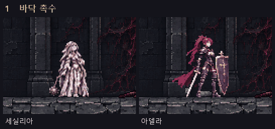
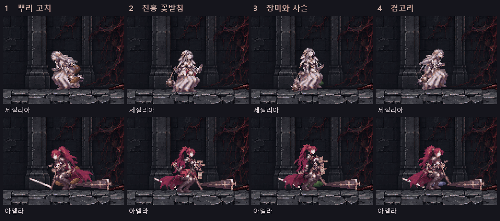

# 보스 사망 연출

2026-11-19 후속 작업에서 동작마다 새로 그린 두 캐릭터의 포즈를 게임에 적용했다. [현재 버전의 보스방 촬영과 캐릭터 원화](CharacterPoses/README.md).

보스 예배당에서 세실리아와 아델라가 치명타를 받았을 때 재생하는 장면이다. 사진 1~3을 개별 공격에, 4~7을 순서대로 네 가지 공통 마무리에 대응시켰다.

| 원인 | 동작 |
| --- | --- |
| 바닥 촉수 | 발밑에서 잿빛 두 마디가 솟고, 몸이 낮아지며 양옆에서 안쪽으로 말린다. 앞 고리가 장화 앞을 지나고 뒤 고리는 어깨 아래에 남는다. |
| 촉수 잡기 | 보스 쪽에서 당겨지는 힘에 무릎이 꺾인다. 한 팔꿈치를 들어 이마를 짚고 다른 손은 무릎 앞에 둔다. 참고 GIF의 4초를 8fps·32칸으로 옮겼다. 2.4초 부근에 손과 어깨가 한 번 더 내려간다. |
| 점액 뱉기 | 날아온 점액이 어깨에 걸린 후 얼굴 양옆을 타고 바닥까지 흘러내린다. 어두운 끈과 바닥의 작은 물결 사이에서 얼굴과 옷깃이 보인다. |
| 휩쓸기 | 기존 쓰러짐을 사용한다. |

공통 사망은 **뿌리 고치 → 진홍 꽃받침 → 장미와 사슬 → 겹고리** 순으로 치명타 한 번에 하나씩 선택한다. 첫 장면은 몸을 옆으로 접어 고치의 틈에 얼굴을 남긴다. 두 번째는 앉은 인물을 들어 올리며 뒤의 붉은 줄기가 펼쳐진다. 세 번째는 등 뒤의 녹색 줄기에서 장미가 피고 사슬이 흔들린다. 네 번째는 옅은 청자색 두 갈래가 어깨 높이로 올라간 뒤 발앞에서 묵직하게 겹쳐진다. 실제 보스에서 나온 세 가닥이 각 자세의 팔과 장화 위치를 따라가며 인물을 보스 앞으로 운반한다.

## 작업 범위

- 기존 캐릭터 도트에서 얼굴·몸통·소매·장비와 접힌 다리를 가져왔다. 앉은 자세는 선 자세의 상체와 웅크린 자세의 옷자락·장화를 허리선에서 잇는다. 이마 손의 팔꿈치는 몸 밖으로 구부리고, 뿌리와 점액은 인물 앞뒤에 따로 그렸다.
- 두 캐릭터에 각 7종, 총 **14시트·280칸**이다. 촉수 잡기는 32칸, 나머지 여섯 종류는 각각 18칸이다. 128×96px, 48 PPU, Point, 무압축이다. 살아 있는 보스 포획은 기존 시트에서 HP 단계에 맞는 자세를 고른다. 이전 공통 키 5·6의 리소스는 보존하며 현재 순환은 1~4다.
- GIF는 Unity Play Mode의 예배당 카메라가 그린 화면을 잘라 편집한 것이다. 실제 촬영 때마다 화면의 재생 키와 사용 중인 텍스처를 함께 검사한다. 참고 사진과의 정량적인 95% 유사도는 측정하지 않았다.

## 재현

2026-11-19 최종 검사에서 Play Mode 185개가 통과했고 19개는 기본 실행에서 제외됐다. 실패는 0개였다. 별도 그래픽 검사 16개도 모두 통과했다. Windows 빌드를 실행해 15초간 기동 상태와 로그를 확인했다. 캐릭터 원본 PNG 41개와 기존 리소스 메타 파일 33개의 해시를 대조했고, 새 연출의 고정 자세 168프레임에서 촉수와 캐릭터 접점의 최대 오차는 0이었다.

Unity 메뉴 `Tools / SaintKnight / Art / Bake Native Defeat Motions` 또는 `SKNativeDefeatBuilder.Bake`로 시트를 생성한다. 게임은 Resources의 시트를 사용한다. 그래픽이 있는 Play Mode에서 `NativeDefeat` 필터를 실행하면 패턴, 공통 장면, 좌우 운반, R 복귀를 확인할 수 있다. 환경 변수 `SK_NATIVE_CAPTURE_ROOT`에 촬영 폴더를 지정하고, 그 아래 `Screens`를 인수로 `python review.py <Screens 폴더>`를 실행하면 위 두 GIF를 다시 만든다.

점액에 들어간 작은 낙숫방울과 물결은 PixelFX 0.3.1의 `water/drip`을 먹빛 팔레트·높이 29px·12fps·천장 그림 없이 내보낸 것이다. 19프레임의 투명 PNG를 에디터 입력으로 포함했다. 게임 빌드에 라이선스 사본을 함께 제공한다. [PixelFX 원본](https://github.com/patch-gg/pixelfx) · [MIT 라이선스](PixelFX-LICENSE.txt)
