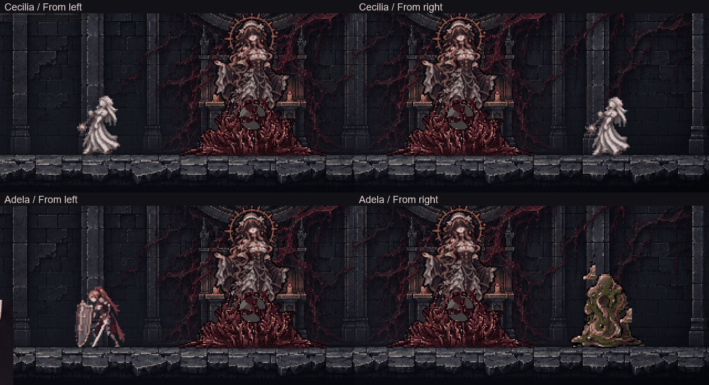

# 보스 앞으로 끌려가는 공통 사망 — 2026-11-18

최신 요청인 “이 자세로 보스에게 가져가기”를 실제 게임에 연결했다. 두 캐릭터 모두 보스 위치에 맞춰 방향을 정하고, 무릎 꿇은 채 앞으로 숙인 자세에서 촉수에 들어 올려져 보스 앞으로 이동한다. 이전의 제자리 마무리 기록은 이번 결과로 이어진다.

## 적용한 모습

- 공통 자세 도입 약0.75초 뒤 운반을 시작한다. 실제 보스의 `Core_Heart` 부근으로 약1.5~3.5초 동안 이동하고, 보스 앞에서 기존10칸 반복을 이어간다. 보스 바닥 촉수·잡기·점액의 개별 도입 이후에도 같은 마무리가 연결된다.
- 넓은 리본처럼 퍼지던 뒤쪽 촉수를 없애고, 윗팔·손목·바깥 무릎의 짧은 감김만 시트에 남겼다. 실제 보스에서 이 세 부위까지 이어지는 촉수는 접점 메타와 현재 프레임에 맞춰 그린다. 느슨한 곡선이 당겨지며 줄어들고, 기존 보스 도트의 질감과48 PPU/Point 픽셀을 사용한다.
- Day06 원본 전신·팔·손·의상·장비를 그대로 입력으로 사용한다. 생성 캐릭터 몸통이나 외부 사진 픽셀은 사용하지 않는다. 세실리아 사슬은 손에 이어지고, 아델라의 떨어진 검·방패는 운반을 따라 떠다니지 않고 원래 바닥에 남는다.
- `SKBossDefeatCarryView`가 그림 레이어만 옮긴다. 플레이어 Rigidbody·충돌체·HP·공격 판정·보스 AI·씬은 변경하지 않았다. 이동 중 예전 위치의 중복 포획 그림을 숨기고, R/비활성화/재시도 때 원래 그림·소재를 복구한다. 치명타를 준 보스 점액이 먼저 사라져도 기억한 보스까지의 운반은 유지한다.

## 실제 게임 촬영과 빌드

- [고정 카메라의 도입·이동·도착 비교](../boss-delivery-review.png)
- [패턴별 도입과 공통 자세](../actual-game-preview.gif), [공통 무릎 자세 확대](../boss-common-kneeling.gif)
- [Windows 실행 파일](../../../../Builds/Win64_NativeDefeat/SaintAndKnight.exe) — 같은 폴더의 Data 등과 함께 사용
- [런타임 운반](../../../../Assets/SaintKnightSpriteCook/Runtime/SKBossDefeatCarryView.cs), [원본 도트 베이크](../../../../Assets/SaintKnightSpriteCook/Editor/SKNativeDefeatBuilder.cs)

사진의 구도·붙드는 방향·자세를 기준으로 조정했으며, 캐릭터 외형은 현재 게임을 기준으로 보존했다. 사진과의 정량95% 일치율을 측정하거나 보장하지 않는다. 아래 촬영은 그래픽 장치가 있는 Unity Play Mode의 실제 카메라 출력이며, 창에서 직접 조작하는 수동 감각 검수는 별도다.

## 최종 검증

| 확인 | 실제 결과 |
| --- | --- |
| 전체 회귀 | **182 통과/실패0/전체201/Explicit19**, `Logs/BossCarry20261118/final-full.xml`, 종료0 |
| 관련 그래픽 검사 | **13/13**, `final-graphics.xml`, 종료0. 기존 원본/접점/원인/복구 검사와 양방향 운반·히트스톱·점액 소멸·비활성화 복구 포함 |
| 원본 보존 | 최초 입력 PNG41개 SHA256 불변. 현재 입력36개도 해시 일치, 생성 캐릭터 입력0개. 새 질감은 기존 보스 잡기 그림의 일부 |
| 시트/접점 | 26시트/468칸,18프레임/8fps/반복8~17. 접점 버전2/160반복 프레임/320접촉부, 기존 촉수·캐릭터 픽셀 간격 최대0.00px |
| 실제 운반 | 세실리아·아델라×좌우4사례, 동작192장+전체16장. 모두 보스 앞으로 도착(가로 거리 약2.80→0.65유닛), `Delivery/index.csv` |
| 기존 장면 재촬영 | 32사례(26사망+6포획), 전체96장+동작576장, `Screens/index.csv` |
| Windows/기동 | `final-build.log` 성공·종료0, 숨김15초 생존·시작 예외 없음. `player-smoke.log`, `player-smoke-state.txt` |

기존 PNG·GUID·씬을 교체하지 않았다. 작업 전 커밋 `eb9d489`. 다른 UI/성소 작업의 변경 파일을 이번 커밋에 섞지 않는다.

재현: `SKNativeDefeatBuilder.Bake` → 그래픽 Play Mode 필터 `NativeDefeat` → 전체 Play Mode → `python Docs/Design/DeathScenes-20261117/export_game_previews.py` → `SKNativeDefeatBuilder.BuildWindows`. 상세 명령·종료 코드는 `Logs/BossCarry20261118/verify-final.ps1`과 같은 폴더에 있다.
