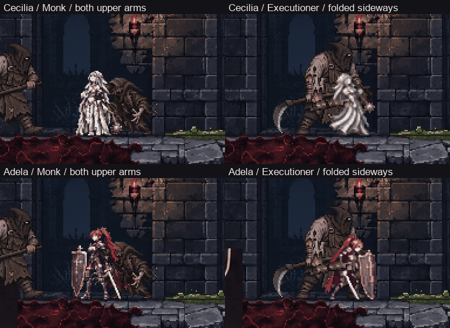
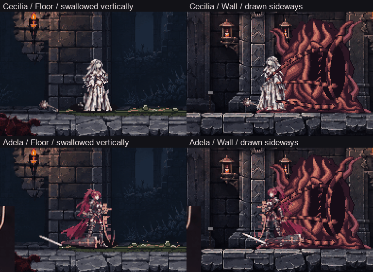

# 남은 일반 적·회랑 사망 동작 적용 — 2026-11-18

사용자가 정정한 남은 범위는 수도사 → 처형인 → 회랑 바닥 → 살덩이 벽이다. 이 네 종류를 세실리아·아델라 모두 현재 게임의 원본 도트로 다시 구성해 연결했다. 일반 점액과 완료된 보스 모션은 그대로 유지했다.

## 최신 사진을 적용한 동작

| 장면 | 동작과 사진 참고 |
| --- | --- |
| 수도사 | 사진1의 양쪽에서 작게 감싸는 구도. 원본 Pounced → Hurt → Held → Crouch로 가드가 무너지고 무릎이 낮아진다. 수도사의 두 소매와 손이 양쪽 윗팔에 닿고, 캐릭터는 앞으로 숙인 채 낮은 붙들림을 반복한다. |
| 처형인 | 사진2의 몸이 옆으로 접힌 작은 구도. 장비를 든 피격 → 앞으로 숙임 → 무릎을 접음 → 옆으로 돌아간 붙들림. 원본 웅크림의 의상·몸·얼굴을 회전하고, 처형인의 원본 팔과 손이 윗팔·바깥 무릎을 받친다. |
| 회랑 바닥 | 사진3~5의 몸이 차례로 감싸지는 과정. 부츠 → 바깥 팔/몸통 → 잠깐 들림 → 같은 바닥 입구로 하강 → 완전히 닫힌 촉수 덩어리. 기존 회랑 질감을 쓴 가는 줄기와 전면 감김으로 수직 방향을 유지한다. |
| 살덩이 벽 | 사진6의 옆에서 끌어들이는 방향. 뒤에서 양쪽 윗팔을 붙들고 한쪽 무릎이 낮아진 상태로 같은 벽 틈에 수평으로 끌려든다. 들어가는 쪽은 벽 앞 주름에 가려지고 머리까지 사라진 뒤 주름과 끝부분만 움직인다. |

사용자가 새 사진의 배치는 에이전트 판단에 맡겼다. 사진7~10은 붙잡힘·무게중심 붕괴·몸이 접히는 중간 자세에 참고했다. 외부 사진의 픽셀이나 의상을 복사하지 않고 원본 캐릭터의 전신·얼굴·복장·장비를 사용했다. 떨어진 무기·방패는 몸을 가리지 않는 바닥 위치에 두며 완전히 흡수된 뒤 외부에 남은 것은 떨어뜨린 장비뿐이다.

## 실제 게임 미리보기

- [도입·중간·마지막 실제 카메라 비교](actual-stage-review.png)
- [Windows 실행 파일](../../../../Builds/Win64_NativeDefeat/SaintAndKnight.exe) — 같은 폴더의 Data 등과 함께 사용
- [일반 장면 도트 베이크](../../../../Assets/SaintKnightSpriteCook/Editor/SKNativeStageDefeatBuilder.cs), [접점 기록](contacts-20261118.json)

## 규격·원본 보존

새로 수정한 범위는 두 캐릭터×4종=8시트/144칸이다. 전체26시트/468칸과18프레임·8fps·반복8~17 규격은 유지한다. 일반128×96px, 벽160×112px,48 PPU/Point/투명 PNG다. 기존 `.meta` GUID와 씬을 교체하지 않았다.

원본 캐릭터 아틀라스에서 몸·소매·팔·손·장비를 사용하고 원본 적 팔로 접점을 맞춘다. 이전에 쓰던 별도 쓰러짐/적 합성 시트는 이 네 장면의 입력에서 제외했다. 사용 입력 수는36→13개로 줄었지만 원본 파일은 삭제하거나 덮어쓰지 않았다. 생성 캐릭터 입력은0개이며, 과거 최초 원본 PNG41개도 SHA256이 모두 같다. 완료된 보스와 회랑 점액 관련 PNG25개도 작업 전후 바이트가 같다.

게임의 기존 원인별 사망·살아 있는 포획·HP에 따른 흡수 깊이·탈출·R 복귀를 사용한다. 이번 수정은 베이크 코드/그림과 검증 코드에 한정하며 런타임의 피해·물리·AI·판정을 변경하지 않는다.

## 최종 검증

| 확인 | 실제 결과 |
| --- | --- |
| 전체 회귀 Play Mode | **185통과/실패0/전체204/Explicit19**, `Logs/EnemyDefeat20261118/final-full.xml`, 종료0 |
| 관련 그래픽 | **16/16**, `final-graphics.xml`, 종료0. 원본 의상 크롭·팔/촉수 접점·서로 다른 흡수 방향·완전 흡수 후 인체 조각 없음·양방향 적 원인·두 캐릭터 R/소재 복구·기존 보스 운반 포함 |
| 원본·완료본 보존 | 원본41 PNG 및 완료 보스/점액25 PNG 변경0. 현재13입력 해시 일치, 생성 캐릭터0,26시트 크기 오류0. `source-proof.json` |
| 신규 장면 접점 | 전체144프레임 중 붙드는82프레임/164접촉부, 실제 팔/손/촉수와 캐릭터 픽셀 간격 최대0.00px. `stage_contacts.json` 및 이 폴더의 접점 기록 |
| 실제 장면 촬영 | 신규8사망+4살아 있는 포획=12사례, 전체36장+동작216장. 전체 모음32사례/전체96+동작576, `Screens/index.csv` |
| Windows 빌드·기동 | `final-build.log` 성공/종료0, 숨김15초 생존·시작 예외 없음. `player-smoke.log`, `player-smoke-state.txt` |

초기 검사의 파일 수 고정 조건(`sources > 15`)은 미사용 합성 입력을 제거한13개 입력을 잘못 실패 처리했다. 최종 검사는 필요한 두 캐릭터·두 적·함정 입력의 실제 경로와 모든 입력 SHA256을 검사한다. 추가 사진 반영 이후 최종16개 그래픽 검사와 전체 회귀·빌드로 다시 확인했다.

사진의 구도·방향·감김 순서를 참고한 결과이며 정량95% 일치율을 측정한 결과는 아니다. 실제 Play Mode 카메라 촬영과 자동 검사를 창에서 직접 조작한 수동 감각 검수로 표현하지 않는다.

재현: `SKNativeDefeatBuilder.Bake` → 그래픽 Play Mode 필터 `NativeDefeat` → 전체 Play Mode → `python Docs/Design/DeathScenes-20261117/StageRevision/export_stage_previews.py` → `SKNativeDefeatBuilder.BuildWindows`. 작업 전 범위 커밋 `94e47b0`, 앞선 보스 완료본 `a0f8d43`.
