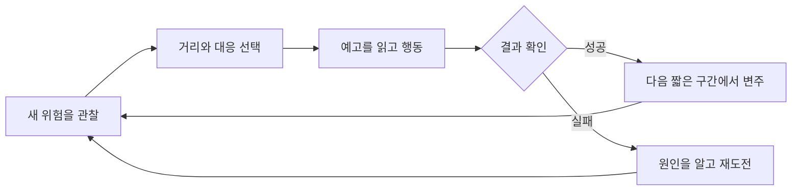

# SiNiSistar 심층 분석과 성녀와 성기사 적용안

후속 변경: 이 문서는 적용 전 조사 기록이다. 사용자 승인으로 반영한 현재 기능과 수치는 [즉시 적용 기록](../REFERENCE_APPLY.md)을 참조한다. 아래의 기존 Day 5 수치는 분석 당시 값이다.

작성일: **2026-11-07 (Asia/Seoul)**. 분석 대상: 사용자가 지정한 **SiNiSistar 1편 RJ247641 로컬 배포본**.

**결론: 우리 게임에 우선 가져올 것은 짧은 구간의 학습 밀도, 행동의 분명한 대가, 읽을 수 있는 공격, 상태를 보여 주는 화면 구성이다.** 성녀와 성기사의 두 인물 전환·사슬과 장검·방패·3D 상태 HUD·별도 정신 시스템에 맞게 독립적으로 설계해야 한다.

조사와 적용 설계 문서를 작성했다. **Day 6은 미착수이며, 사용자에게 시작 여부를 먼저 확인한다.** 캐릭터 디자인 준비 대기 조건도 유지한다. 원본 게임의 코드·그림·음원을 우리 게임에 넣지 않았고, Unity 런타임 코드·씬·아트를 수정하지 않았다.

## 1. 읽는 순서와 증거 구분

| 문서 | 용도 |
| --- | --- |
| 이 문서 | 핵심 설계 해석, 적용 우선순위, 전체 연결 |
| [Day 6 검토안](SINISISTAR_DAY06_REVIEW.md) | 시작 전에 확인할 범위와 결정, 디자인 입력, 합격 기준 |
| [웹 조사](SINISISTAR_WEB_RESEARCH.md) | 공식 상품 설명·출시 당시 분석·공략·한국 커뮤니티, 접근 한계 |
| [로컬 배포본 분석](SINISISTAR_LOCAL_ANALYSIS.md) | 공격·피해·상태·적·카메라·저장 CIL 경로와 Evidence ID |
| [프로젝트 대조표](SINISISTAR_PROJECT_MAPPING.md) | 실제 Day 5 코드·씬 수치, 파일과 줄 근거 |
| [실행 관찰 기록](SINISISTAR_RUNTIME_OBSERVATIONS.md) | 거점·메뉴·지도·숲 화면의 관찰 범위 |

표현 기준은 다음과 같다. **직접 관찰**은 실행 화면 또는 로컬 소스/관리 코드에서 확인한 내용이다. **문헌 사실**은 링크된 작성자가 설명한 내용이며 판본과 관찰자를 구분한다. **해석**은 여러 증거로부터 도출한 설계 판단이다. **제안**은 아직 승인·구현되지 않은 우리 게임의 선택이다. 내부 변수명이나 클래스 이름만으로 게임 동작을 확정하지 않는다.

REA 스킬의 독립 조사 절차에 따라 웹 조사·로컬 정적 분석·프로젝트 대조를 나누어 수행했고, Computer Use 스킬로 실행 화면을 확인했다. 게임 분석에 직접 도움이 되는 이 두 스킬을 사용했다. 이미지 생성·모델 제작·플러그인 설치는 이 조사에 필요하지 않았다.

## 2. 판본부터 정확히 잡기

동봉 readme의 표기는 **v3.0.1p**, 코드 내부 버전과 실제 설정 화면의 표기는 **3.0.0**이다. 파일명이 같다고 세 표기를 억지로 통일하지 않는다. 로컬 DLL의 SHA-256과 MVID는 정적 보고서에 보존했다.

Steam 1794780은 **Lite판**이며 공식 일본어 설명은 본편 6스테이지와 추가 스테이지 미포함을 명시한다. 반면 본편 마지막 악몽을 독립 구간으로 센 실제 플레이 공략에는 본편 7구간과 추가 2구간이 나온다. 따라서 숫자만 가져와 사용자 파일의 전체 구성을 확정하면 안 된다. 2편의 탐색·성장·마법 시스템도 이번 대상에서 제외했다. [Steam 공식 설명](https://store.steampowered.com/app/1794780/sinisistar?l=japanese), [실제 플레이 공략](https://retorohide.blog.fc2.com/blog-entry-1113.html)

YouTube 원작 영상은 찾았지만 영상 열기에 실패했다. 시청한 것처럼 장면별 프레임이나 타임스탬프를 제시하지 않는다. 나무위키는 접근 가능한 미러를 사용했고, 디시의 실제 글은 소수 개인의 의견으로만 취급했다. 공식 개발자 Ci-en 원문도 접근 실패 범위를 기록했다.

## 3. 핵심 경험: 익숙한 조작으로 새로운 위험을 읽는다

출시 직후 분석은 짧은 구역마다 새 적을 만나고, 행동을 이해한 뒤 다음 구역으로 넘어가며, 실패해도 짧게 돌아오는 흐름을 강점으로 평가했다. 이 판단은 해당 작성자의 당시 플레이 기록에 근거한다. [2019년 분석](https://gamebunseki.hatenablog.com/entry/2019/09/10/013616)

이를 설계 언어로 옮기면 다음과 같다.

**해석:** 원작의 밀도는 적 종류의 수만으로 설명되지 않는다. 새 위험을 발견하는 간격과 실패 후 다시 실험하는 간격이 짧아야 한다. 같은 적이라도 평지·좁은 통로·다른 적과의 혼합은 다른 질문이 된다. 우리 체험판은 긴 맵을 채우기보다 A와 B로 이 순환을 성립시키는 편이 우선이다.

공포와 불공정함은 다른 축이다. 어두운 장소와 위협적인 연출을 유지하면서도 공격의 전조와 피격 원인을 읽을 수 있게 할 수 있다. 화면 밖 공격, 보이지 않는 판정, 긴 복귀 거리는 이 순환을 약하게 만들 수 있다. 이는 원작의 모든 구간이 공정하다는 평가가 아니라 우리 게임의 목표다.

## 4. 전투: 공격 종류보다 선택의 비용이 중요하다

공식 소개의 검은 짧고 빠르며, 활은 먼 곳을 노릴 수 있지만 탄수 제약이 있다. 로컬 코드에서는 활의 입력 유지·방향 선택·입력 해제 후 발사·회복과 발사당 1 소비 경로가 확인된다. 내부 `Stamina`는 이 맥락에서 화살 자원이므로 자동 회복 지구력 시스템으로 읽으면 안 된다. [Steam 공식 설명](https://store.steampowered.com/app/1794780/sinisistar?l=japanese), [로컬 분석 2~3절](SINISISTAR_LOCAL_ANALYSIS.md)

**해석:** 원거리 공격이 안전하다면 다른 비용이 필요하다. 근접 공격이 빠르다면 접근 위험이 대가다. 선택은 피해 수치뿐 아니라 위치·시간·자원·취소 가능성으로 만들어진다.

### 현재 두 캐릭터와 연결

| 실제 Day 5 값 | 세실리아 | 아델라 | 의미 |
| --- | --- | --- | --- |
| 피해 / 최소 공격 간격 | 20 / 0.45초 | 25 / 0.55초 | 명중을 전제한 이론 DPS 44.4 / 45.5 |
| A 60HP 처치 타수 | 3 | 3 | 피해량 차이가 선택 이유로 거의 드러나지 않음 |
| B 80HP 처치 타수 | 4 | 4 | 같은 문제 |
| 공격 활성 시간 | 0.18초 | 0.20초 | 원작 수치가 아닌 우리 씬의 현재값 |
| HP / 이동속도 | 100 공유 / 3.6 | 동일 | 전환이 별도 생존 자원으로 작동하지 않음 |

근거와 계산 가정은 [프로젝트 대조표 3절](SINISISTAR_PROJECT_MAPPING.md)에 있다. 실측 DPS나 버그 판정이 아니다.

**Day 7 제안:** 세실리아는 사슬의 거리 관리, 아델라는 장검의 근접 확실성을 우선 검토한다. 예컨대 세실리아가 넓은 간격에서 먼저 대응하고 아델라가 짧은 빈틈에 확실한 보상을 얻도록 할 수 있다. 다만 현재 아델라의 판정이 조금 더 길기 때문에 이 역할은 기존값의 설명이 아니라 **추후 재설계 후보**다.

사슬 제어·방패 가드·패링·추가 탄약을 한 번에 넣지 않는다. 두 기본 공격과 기존 전환만으로 특정 상황에서 선택이 달라지는지 먼저 본다. 새 시스템은 이를 해결하지 못할 때 별도 범위로 검토한다. 원작은 단일 인물의 무기 선택 구조이므로 2인 전환 규칙은 우리 게임이 새로 결정해야 한다.

### 전환 정책

현재 전환은 진행 중인 공격을 취소하지만 쿨타임은 보존한다. 이 안정성을 유지한다. 추후에는 다음 질문을 분리한다.

- 공유 HP는 두 인물이 하나의 전투 자원을 나눈다는 의도인가?
- 전환이 위치·사거리의 해법인가, 위험 회피 수단인가?
- 공격·피격·공중의 어느 구간에서 전환을 허용하는가?
- 전환을 연타했을 때 후딜·피해·애니메이션이 중복되거나 사라지는가?

현재 정책을 분석만으로 바꾸지는 않았다.

## 5. Day 6의 실제 핵심: 그림과 판정이 같은 사건을 말하게 하기

로컬 코드에서는 지상·공중 근접 애니메이션 분기, 캐릭터와 무기의 표현, 피격·사망·애니메이션 이탈 시 공격 종료가 확인된다. 일부 적은 공격 Collider를 켜고 끄는 함수가 분리돼 있다. 실제 타격 프레임 수는 미측정이다. [로컬 분석 1·6절](SINISISTAR_LOCAL_ANALYSIS.md)

우리 코드는 **입력 즉시 Hitbox 활성화**다. 준비 동작이 긴 새 Attack 시트를 연결하면서 판정은 그대로 두면 무기가 움직이기 전에 적이 맞는다. 이것이 가장 먼저 막아야 할 불일치다.

현재 공격 중 이동·점프·전환은 가능하고 몸의 방향도 바뀔 수 있지만, Hitbox 방향은 공격 시작 때 고정된다. 반대 방향을 누르면 그림과 판정이 갈라질 가능성을 검수해야 한다. 이는 코드에서 확인한 조건이며 이번에 Unity 실행으로 재현한 버그는 아니다.

**추천 연결 방식:** 기존 전투 상태와 공격 시간축을 기준으로 애니메이션을 표현한다. 판정 시작·종료를 두 곳에서 따로 발생시키지 않는다. Animation Event를 선택하더라도 취소된 공격의 오래된 이벤트가 살아나지 않도록 현재 공격을 검증한다. 피격·사망·비활성·전환은 표시와 판정 양쪽을 함께 종료해야 한다.

선딜 추가, 공격 중 방향 잠금, 이동 제한은 조작감 변경이므로 디자인 입력과 함께 결정한다. 원작의 0.2초 기본 피격 상수를 우리 값으로 복사할 이유는 없다. 현재 우리 플레이어 무적 0.55초·경직 0.16초와 적 무적 0.12초는 서로 목적이 다르다. [상세 검토안](SINISISTAR_DAY06_REVIEW.md)

## 6. 적·보스: 서로 다른 판단을 요구해야 한다

공략에는 등불을 떨어뜨려 근접 기회를 만드는 첫 보스, 투사체를 처리해 화살을 확보하는 전투, 부위를 처리한 뒤 약점을 공격하는 구조가 나온다. **해석:** 환경과 적의 행동이 공격 기회를 만들어 주면 회피와 공격이 하나의 순환이 된다. 모든 보스를 큰 HP 상자로 만들 필요가 없다. [공략의 해당 사례](https://retorohide.blog.fc2.com/blog-entry-1113.html)

현재 A/B는 다음처럼 이미 다른 시간 구조를 가진다.

| 실제 값 | A | B |
| --- | --- | --- |
| 예고 | 0.4초 | 0.85초 |
| 공격 시작 거리 | 1.1 | 1.5 |
| 활성 / 회복 | 0.18 / 1.0초 | 0.25 / 1.5초 |
| 피해 | 15 | 25 |

**제안:** A는 간격을 재는 기본 압박, B는 크게 예고하고 넓게 치는 위험으로 읽히게 한다. 두 적의 외형은 아직 같은 훈련 표적이므로 동작·실루엣 차별화는 디자인 준비가 필요하다. 수치만 더 올리기보다 예고 자세·공격 방향·회복 자세를 구분한다.

추가 적은 점프·높이·원거리·진로 제한 중 기존 A/B가 묻지 않는 질문 하나를 담당하게 한다. 첫 보스는 A의 간격 읽기와 B의 큰 예고를 재사용하고, 환경 상호작용 하나를 더하는 정도가 체험판 범위에 맞다. 새로운 몬스터·보스·오브젝트의 제작은 이번 조사에서 승인하거나 착수하지 않았다.

## 7. 첫 스테이지 설계 초안

아래는 원작 맵의 복제가 아닌 독자 제안이다. 원래 Day 9 이후 일정에 해당한다.

| 순서 | 구간 | 학습할 판단 | 배치 조건 |
| --- | --- | --- | --- |
| 1 | 안전한 진입 | 이동·점프·전환 | 실패해도 큰 손해 없는 공간 |
| 2 | A 단독 | 내 사거리와 물러날 거리 | 퇴로를 확보한 평지 |
| 3 | B 단독 | 예고를 기다린 뒤 반격 | 예고 전체와 회피 공간이 화면에 보임 |
| 4 | 짧은 지형 변주 | 공간이 달라지면 같은 적에 어떻게 대응하는가 | 새 행동과 새 지형을 동시에 과하게 도입하지 않음 |
| 5 | A+B 조합 | 우선순위와 위치 선정 | 두 공격이 언제나 겹치지 않게 첫 진입 조정 |
| 6 | 휴식과 보스 예고 | 다음 위험을 예상 | 체크포인트·상태 확인 |
| 7 | 보스 | 배운 규칙을 조합 | 새 규칙은 한 가지부터 검토 |

구간별로 **첫 발견 → 첫 피격 → 첫 성공 → 실패 후 재도전** 시간을 따로 기록한다. 초보자가 죽은 횟수만으로 난이도를 판단하지 않는다. 실패 이유를 설명하고 다음 시도에서 바꾸는 행동이 있으면 학습이 일어난 것이다.

체험판 목표 시간과 구역 수는 프로토타입 검증 후 정한다. 원작의 전체 구역 수를 30일 일정의 생산 목표로 삼지 않는다.

## 8. 화면·도트·3D HUD: 시선의 역할을 나눈다

실행 화면에서 큰 왼쪽 인물 초상과 상단 자원 표시, 작은 전투 캐릭터를 확인했다. 거점은 밝은 창·촛불·지도 책상이 어두운 배경에서 구분된다. 이것은 직접 관찰이며 정확한 화면 비율은 미측정이다. [실행 기록 R02~R03](SINISISTAR_RUNTIME_OBSERVATIONS.md)

**제안:** 전투 공간은 위치·사거리·즉시 위험을 담당하고 측면 HUD는 상태·인물의 변화를 담당한다. 공격 경고를 3D 초상에만 넣지 않는다. HP 손상 0~4와 정신 침식은 독립 데이터로 유지하고, 표시가 그 데이터를 함께 읽게 한다. 원작에 같은 정신 게이지가 있다고 확인한 것은 아니다.

현재 프로젝트는 왼쪽 25%와 세로 여백을 둔 카메라 때문에 전투 뷰가 전체 면적의 56.25%다. 1920×1080, 현 카메라, 48 PPU 가정에서는 원본 1px가 화면 2.25px가 된다. 따라서 Point 필터만으로 픽셀의 일정한 크기를 보장하지 않는다. Day 8에 가상 해상도·정수 배율·HUD 폭·전방 시야를 함께 검토해야 한다. [계산과 실제 씬 근거](SINISISTAR_PROJECT_MAPPING.md)

48px는 계획상 몸체 높이의 출발점이며, 프레임 전체 크기나 원작 실측치가 아니다. 사슬이 크게 뻗는 프레임의 캔버스가 커져도 몸체 비율과 발바닥 피벗은 유지해야 한다. 원본 그림을 따라 그리는 방식 대신 승인된 두 인물의 디자인에서 동작 가독성을 확보한다.

## 9. 피드백·공포·실패 연출

로컬 코드에는 적중·마무리 소리, 넉백, 화면 흔들림 관련 경로가 있고 피격과 무적 시간이 분리되어 있다. 하지만 실제 음향을 청취하거나 원작 히트스톱을 측정하지 않았다. 우리 프로젝트의 0.045초 히트스톱은 기존 구현값이다. [로컬 분석 4~5·8절](SINISISTAR_LOCAL_ANALYSIS.md)

**제안:** 피드백은 정보를 나눠 전달한다. 휘두르는 소리는 행동 시작, 명중음은 실제 피해 승인, 피격 자세는 조작 불가, 무적 표시는 재피격 불가를 알려야 한다. 적중이 거부됐는데 명중음·히트스톱만 반복되는 현상은 막는다. 화면 흔들림이 공격 예고를 읽기 어렵게 만들면 강도를 낮춘다.

공포는 암부만 늘려서 만들지 않는다. 안전한 구간 뒤의 변화, 불길한 배경 오브젝트, 공격 전 잠깐의 정적, 이해 가능한 위험을 조합하는 방향을 제안한다. 성인 대상의 패배·손상 연출은 비노골적인 기능 관점에서만 다뤘다. 본 조사로 기존 캐릭터 디자인이나 표현 수위를 변경하지 않는다.

실패 연출을 반복할 때는 빠른 재도전 경로가 필요하다. 기록·갤러리는 별도 동기이며, 필수 전투 진행을 막는 조건으로 자동 결합하지 않는다. 완성 전투보다 갤러리 물량을 먼저 늘리지 않는다.

## 10. 체크포인트와 저장은 별도 계약이다

정적 분석에서 재시작·스테이지 선택 관련 타입과 두 저장 파일을 시도하는 구조가 확인됐다. 이것만으로 모든 구역의 자동 저장 위치가 확정되지는 않는다. [로컬 분석 10절](SINISISTAR_LOCAL_ANALYSIS.md)

Day 20~21 제안은 다음과 같다. 체크포인트는 현재 시도의 재시작 위치를, 저장은 프로그램을 종료한 뒤 복구되는 상태를 정의한다. HP·적·오브젝트·카메라·진행 플래그·정신 상태 중 무엇이 복원되는지 명시한다. 현재 훈련용 R은 제품의 저장 시스템이 아니다. 재시작 때 멈춘 시간이나 공격 상태가 남지 않게 한다.

HP와 탄약을 회복하려고 일부러 실패하는 것이 늘 최선이 되지 않도록 보스 앞 준비 정책도 검토한다. 난이도는 피해 배율, 예고, 자원, 복귀 비용 중 어떤 부분을 조절하는지 분리한다. 원작 생성자에 있는 Easy 배율은 실제 씬의 최종값으로 확정하지 않았으며 우리 밸런스 목표로 채택하지 않는다.

## 11. 적용 우선순위와 범위

| 우선순위 | 시기 | 적용 주제 | 이유 |
| --- | --- | --- | --- |
| P0 | Day 6 승인 후 | 애니메이션·판정·취소의 일치 | 눈에 보이는 행동을 믿을 수 있어야 함 |
| P1 | Day 7 | 두 캐릭터의 상황별 이점 | 현재 피해량 차이만으로는 처치 타수가 같음 |
| P1 | Day 8 | 유효 전투 시야와 픽셀 표시 | 위험을 읽을 수 있는 화면 확보 |
| P1 | Day 9~12 | 짧은 A/B 학습 구간과 조합 | 새 기능보다 기존 기능의 재미 검증 |
| P2 | Day 13~17 | HP 손상·정신 상태·3D HUD 분리 | 프로젝트 고유 특징을 일관되게 표현 |
| P2 | Day 18~21 | 명중 피드백·재도전·저장 | 반복 플레이 품질 |
| P2 | Day 22~25 | 배운 규칙을 사용하는 보스 | 체험판 완결 |
| P3 | Day 26~30 | 설정·기록·최적화·배포 검수 | 제품 마무리 |

이 표는 기존 30일 로드맵에 분석을 연결한 검토안이다. 일정 변경이나 추가 제작을 실행한 것이 아니다. 기존 GLB 유지, 캐릭터 디자인 변경 금지, 실제 전투 2D·측면 HUD 3D 원칙을 보존한다.

## 12. 조사 완료 범위와 남은 검증

| 질문 | 이번 결론 |
| --- | --- |
| 기본 경험과 차별성 | 공식 설명·독립 플레이 문헌·로컬 구조를 종합해 답변 |
| 전투·상태·적·카메라·저장 구조 | 선택한 40개 타입의 정적 코드 근거 확보. 전 코드 해독 아님 |
| 화면과 메뉴 | 거점·설정·지도·숲 화면 직접 관찰 |
| 정확한 조작감·프레임 | 미측정. 사용자 입력과 창 전환이 섞여 통제된 전투 실험이 되지 않았음 |
| 전체 적·보스·스테이지 | 문헌 기반 분석. 직접 전 구간 클리어하지 않음 |
| 음악·음성 | 코드와 리뷰의 범위만 확인, 직접 청취 평가 없음 |
| 한국 커뮤니티 | 디시 원문 2개와 위키 미러 확인, 전체 여론으로 일반화하지 않음 |
| 현재 게임에 대한 적용 | 실제 코드·씬과 연결한 우선순위 및 Day 6 검토안 작성 |
| 구현·기존 기능 검증 | 구현 없음. 기존 28/28 테스트 기록 확인, 이번 재실행은 하지 않음 |

따라서 **개발 방향을 정하기 위한 심층 조사와 적용안 작성은 완료**, 정확한 원작 수치의 전수 실측과 전 구간 플레이는 완료 범위 밖이다. 확인되지 않은 내용을 우리 게임의 확정 스펙으로 만들지 않았다.

**다음 단계는 사용자 검토다. Day 6 시작 여부와 디자인 준비 상태를 확인한 뒤에만 구현한다.**
