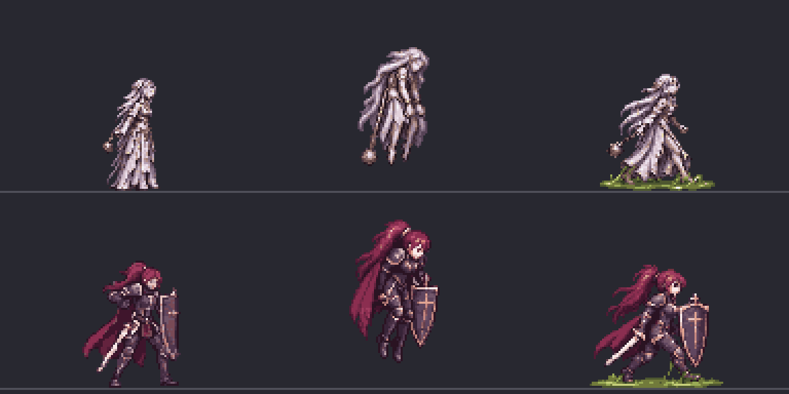
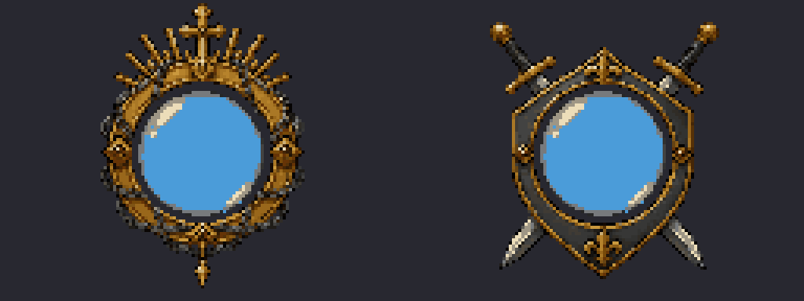

# 요청 도트 7장 제작·규격 통일·Sprite 분할

작업일: 2026-11-13 (Asia/Seoul). 게임 상태에 연결하기 전의 검수용 에셋이다.

## 이번 결과

이전 세실리아 v3를 그대로 보존하고, 아델라 적 쓰러짐을 정규화했다. 남은 보스 2장·함정 반응 2장·HP 장식 1장은 기존 시안과 승인 캐릭터 도트를 직접 참조하는 내장 ImageGen 편집으로 제작했다. SpriteCook 추가 생성·결제는 하지 않았다. SpriteCook으로 생성한 아델라 원본은 Pro·1K이며, 남은 다섯 장을 SpriteCook `high`로 생성했다고 표현하지 않는다.

| 정규화 파일 | 구성 | 크기 |
| --- | --- | --- |
| `4_enemy_death_cecilia_v3.png` | 붙들려 쓰러짐4·큰 공격에 쓰러짐4 | 512×192 |
| `4_enemy_death_adela_v2.png` | 위와 같음 | 512×192 |
| `2_boss_pattern_cecilia_v2.png` | 휩쓸림4·들림4·탈출1·사망2 | 512×288, 마지막 칸 비움 |
| `2_boss_pattern_adela_v2.png` | 위와 같음 | 512×288, 마지막 칸 비움 |
| `3_trap_reaction_cecilia_v2.png` | 가시 피격3·점액 걷기4·대기2 | 384×288 |
| `3_trap_reaction_adela_v2.png` | 위와 같음 | 384×288 |
| `5_hp_orb_ornaments_v2.png` | 유리 구슬·세실리아 장식·아델라 장식 | 384×96 |

총 **7시트 / 캐릭터 56프레임 + UI 3부품 = 59개 Sprite**. 별도로 앞서 수정한 보스 점액 합성 2시트·46프레임은 유지했다.

## 규격과 디자인

- 모든 칸·개별 PNG는 128×96, 48 PPU, Point, 무압축, mipmap 없음이다. 캐릭터는 한 가지 비율로 최근접 축소하고 승인 원본 32색을 사용한다. 점액 반응만 올리브 5색을 더 허용한다.
- 첫 서 있는 포즈 기준 세실리아 55px·아델라 62px. 몸을 굽히거나 누운 포즈의 높이를 억지로 같은 키로 늘리지 않는다.
- 기존 캐릭터 피벗 `(0.5, 0.26625)`와 발높이 y92를 유지한다. 보스 들림 4칸은 발끝을 y80에 두어 12px 위로 띄웠다. UI 피벗은 `(0.5, 0.5)`다.
- 긴 은발·장식 의상·사슬의 세실리아 디자인과 적갈색 포니테일·갑옷·망토·검/방패의 아델라 디자인을 기준으로 비교했다. 기각된 짧은 머리 세실리아 v2는 참조하지 않았다. 이미 검수한 세실리아 v3 시트·JSON은 바이트 단위로 그대로 유지했다.
- 점액 걷기 4칸의 발·아랫옷/망토 위치가 서로 다르다. 원본 전체 시트의 색·체형을 보존하면서 재생성한 것으로, 모든 포즈가 원본 픽셀과 동일하다는 뜻은 아니다.
- UI 구슬은 금테를 제거했다. 세 부품 중심 `(64,49)`, 유리 지름40px·장식 안쪽 지름44px로 맞췄으며 실제 알파 겹침은 0픽셀이다. 미리보기의 파란 충전색은 PNG 부품에 포함하지 않았다.

## 파일과 재현

- 편집 원본: `Docs/Design/Stage/spritecook/*_v2.png` 및 `4_enemy_death_cecilia_v3.png` (큰 이미지, 게임용으로 직접 사용하지 않음).
- 정규화 시트·JSON·컨택트·미리보기·검증: `Docs/Design/Stage/spritecook/completed-pack/`.
- Unity 정규화 시트: `Assets/SaintKnightSpriteCook/Drafts/`의 위 표 7개 PNG와 JSON. 시트 자체는 일반 Texture다.
- **실제로 Sprite로 임포트하는 파일**: `Assets/SaintKnightSpriteCook/Drafts/Sliced/<시트 이름>/00.png` 등 59개. `Sprite (2D and UI)`·Single·Full Rect로 각각 등록했다. 기존 시트와 GUID는 유지했다.
- 빌더: `python Docs/Design/Stage/spritecook/build_completed_drafts.py`; `--sync-drafts`는 신규 시트/분할 파일을 복사한다. 다른 내용의 기존 에셋은 덮어쓰지 않고 중단한다.
- 정확한 다섯 편집 프롬프트: `Logs/SpriteCookCompletion/20261113/edit-requests.json`.
- 변경 전 44파일·해시: `Logs/SpriteCookCompletion/20261113/Before/`, `before-hashes.json`.

## 검사

서로 다른 출력 폴더로 재생성한 PNG·JSON·GIF **84파일 해시 일치**. 기존 Assets 35개(원본 아트·기존 메타·게임 코드 포함) 해시 보존. 칸/키/알파/팔레트/잘림·프레임 중복·들림 간격·UI 겹침을 빌더에서 검사했다. 앞서 수정한 점액 합성 검사도 6/6 통과했다. 전체 7시트 컨택트를 실제 도트 크기로 확대해 검수했다.

Unity 검사는 `SpriteCookDraftImportTests`의 실제 Sprite 59개 로드·PPU/피벗/필터/압축, 들림 간격, 유리/장식 겹침 검사와 기존 Play Mode 회귀를 함께 실행한다. **신규3개 포함 149/149 통과**(전체162, Explicit13, 실패0, 종료0). [결과 XML](../Logs/SpriteCookCompletion/20261113/PlayMode/playmode-results.xml), 로그는 같은 폴더에 있다.

## 남은 작업

**이번 결과는 Drafts 준비 완료이며 게임 화면 연결은 아직이다.** Resources·런타임 코드·씬은 바꾸지 않았다. 보스/적 원인별 모션 선택, 기존 함정 반응 교체, HP 구슬/장식 HUD 레이어 연결 후 실제 장면·타이밍·조작감을 검수해야 한다. 수동 플레이·새 Windows 빌드는 하지 않았다.

위쪽 세실리아·아래쪽 아델라, 왼쪽 적 쓰러짐·가운데 보스 들림·오른쪽 점액 걷기. 아래 선은 바닥 기준이다.

