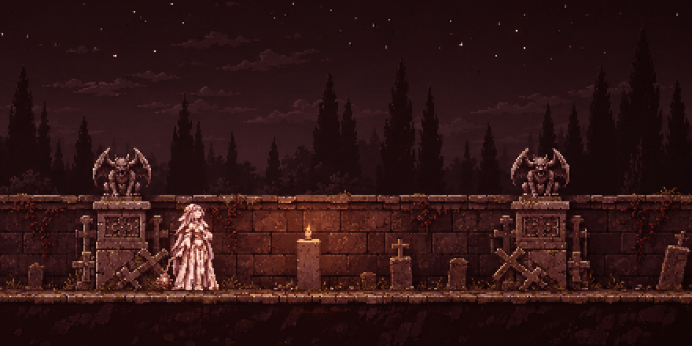
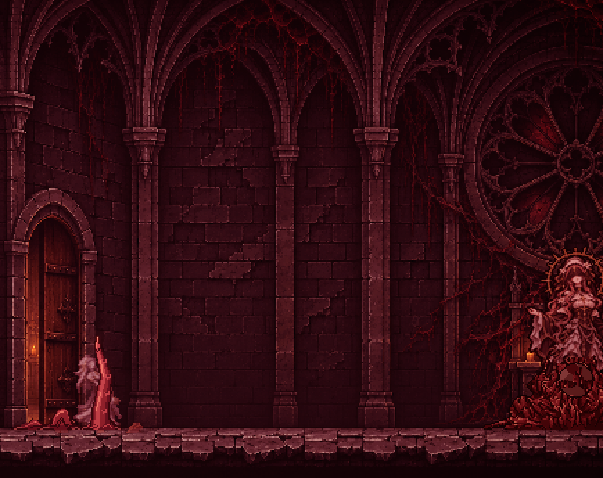
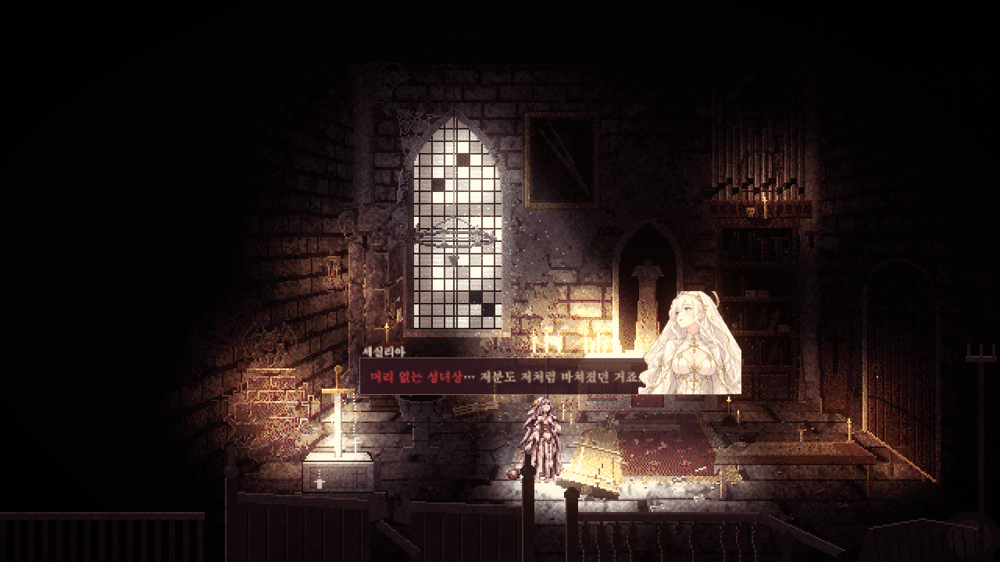
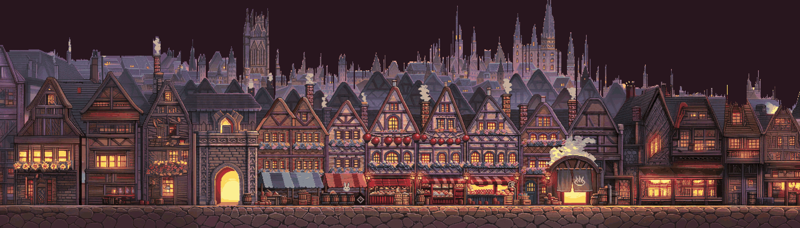

# 성녀와 성기사 (Saint and Knight)

Unity 6로 만든 다크 고딕 **2D 도트 횡스크롤 액션** 프로토타입.
사슬을 쓰는 성녀 **세실리아**와 장검·방패를 쓰는 성기사 **아델라**를 Tab으로 바꿔 가며 무너진 대성당을 지나 첫 보스 「장미창의 성모」를 쓰러뜨린다.

| 1스테이지 — 무너진 대성당 | 보스 예배당 |
| --- | --- |
|  |  |

| 성소(로비) 대화 | 마을 (하루 주기 하늘·조명) |
| --- | --- |
|  |  |

## 한눈에

- **엔진**: Unity 6000.0.81f1 · URP 2D · New Input System · C#
- **규모**: 런타임/에디터 스크립트 약 70개, Play Mode 자동 테스트 약 200개(최근 실행 199 통과 / 실패 0)
- **흐름**: 타이틀 → 성소(로비) → 1스테이지 → 보스 예배당 → 마을 → 성소
- **개발 방식**: 1인 개발. 하루 단위 목표(Day 1~30)로 기능을 쌓고, 매 단계 자동 테스트와 작업 기록을 남겼다. AI 도구(Claude Code, Codex)를 페어 프로그래머로 활용.

## 조작

| 동작 | 키 |
| --- | --- |
| 이동 | A / D (← / →) |
| 상호작용·문 들어가기 | W (↑) |
| 웅크리기 | S (↓) |
| 점프 | Space |
| 공격 | J |
| 캐릭터 전환 | Tab |
| 재시작 | R |
| 설정 / 일시정지 | Esc |

모든 키는 설정 화면에서 바꿀 수 있다(`SKBindings`).

## 구현 포인트

### 전투
- **공격 3단계(준비 → 타격 → 회복)**: 준비 중에는 판정 범위만 흐리게 보여 주고 Collider는 끈다. 한 공격은 한 대상에 한 번만 피해를 준다. 히트스톱은 공격 타이머와 물리를 같은 scaled time으로 멈춘다 (`SKPlayerCombat`).
- **단일 소유 원칙**: 입력은 `SKDay01Player`, 공격 시간은 `SKPlayerCombat`, HP와 피해 승인은 `SKHealth`만 다룬다. 상태 우선순위 Disabled → Dead → Held → Hurt → Windup → Attacking → Recovery → Ready.
- **두 캐릭터의 차별화**: 세실리아는 빠르고 가벼운 사슬 연타에 적의 다음 공격을 늦추는 견제, 아델라는 느리고 무거운 일격에 적의 공격 아머를 부수는 특성을 가진다. 전환은 공격을 취소하되 쿨타임은 보존한다.
- **적 AI**: 예고가 분명한 근접·대형 공격, 반격 아머, 잡기와 연타 탈출, 높은 공격은 웅크려서 피하기.
- **보스 「장미창의 성모」**: 페이즈 전환과 패턴 3종, 촉수 잡기 연출 (`SKBossAgent`).
- **환경 함정**: 바닥 촉수, 점액 웅덩이(이동 ×0.5), 살덩이 벽. 잡히면 연타로 탈출하고, 버티지 못하면 HP가 깎인다.

### 시스템
- **HP 기반 외형 손상 0~4단계**: HUD 일러스트와 캐릭터 표시가 같은 판정 함수(`SKHealth.DamageStageFor`)를 공유한다.
- 체크포인트·저장·씬 간 HP와 캐릭터 유지, 자동 회복, 게임 오버 후 즉시 재시작.
- 데이터 주도 스테이지: 레이아웃 JSON 하나에서 배경 그림과 충돌이 함께 생성된다.
- 머리 위 대화 상자(`SKDialogue`), 씬별 색감(`SKAtmosphere`, URP Volume을 코드로 생성), 마을 하루 주기 하늘·조명(`SKVillageSky`).
- 1인칭 상점(장소 그림 → A/D 둘러보기·W 걷기), 플레이어 추적 가로 카메라.

### 테스트와 도구
- `Assets/Tests/PlayMode/`: 전투 계약, 캐릭터 전환, 손상 단계, 함정, 보스, 씬 이동, 저장을 검증하는 Play Mode 테스트.
- 그래픽 확인용 `[Explicit]` 캡처 테스트로 실제 게임 화면을 자동 촬영해 검수했다.
- 에디터 메뉴 `Tools > SaintKnight > …`로 로비·마을 씬을 다시 생성할 수 있다.
- `Docs/Design/**/make_*.py`: 도트 변환, 팔레트 축소, 스프라이트 시트 정규화 같은 아트 파이프라인 스크립트.

## 실행

1. Unity Hub에서 **6000.0.81f1**로 이 폴더를 연다.
2. `Assets/SaintKnightDay26/Scenes/Title.unity`를 열고 Play. (빌드 첫 씬도 타이틀이다.)
3. 테스트: Window > General > Test Runner > PlayMode > Run All.

일부 고해상도 일러스트는 저장소에 포함되지 않았다. 그림이 없는 자리는 게임이 저장소의 기본 도트 그림으로 대신 그린다.

## 레퍼런스

- 진행 방식·화면 구조·조작 흐름은 2D 액션 **SiNiSistar**를 참고했다. 원작의 이미지·코드·음원은 사용하지 않았고, 캐릭터·적·보스·스테이지는 이 프로젝트에서 새로 디자인했다.
- 분석 기록: [심층 분석](Docs/Research/SINISISTAR_DEEP_ANALYSIS.md), [적용 내역](Docs/REFERENCE_APPLY.md)

## 문서

- [마스터 기획](Docs/MASTER_PLAN.md) · [구현 현황](Docs/IMPLEMENTATION_STATUS.md) · [스토리](Docs/Design/STORY.md) · [보스 설계](Docs/Design/Boss/BOSS_ROSE_MADONNA.md)
- 일차별 개발 기록: [Day 12](Docs/DAY12.md) · [Day 13](Docs/DAY13.md) · [Day 14](Docs/DAY14.md) · [Day 15](Docs/DAY15.md) · [Day 17~30](Docs/DAY17_30.md)
